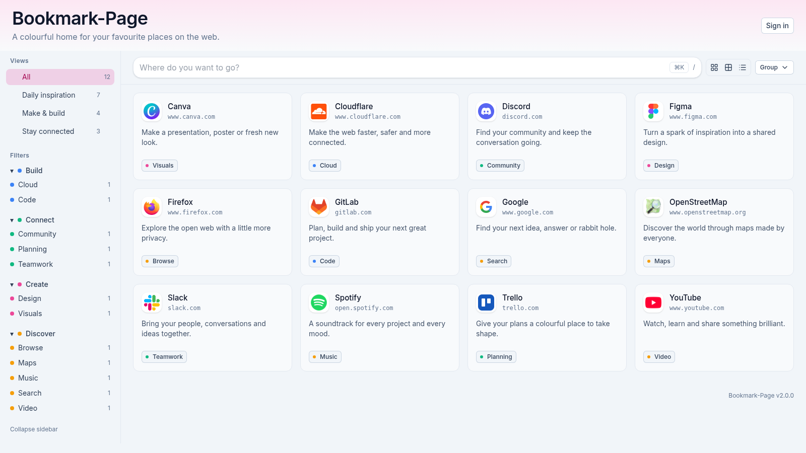

# Bookmark-Page



V2 of Bookmark-Page, a device portal for broadcast engineering labs, maintained on `main`.

- V1 (legacy) is on branch `v1`. The legacy image is `adihilber/bookmark-page`.
- V2 images are published to `ghcr.io/leeo86/bookmark-page`. A git tag `v2.x.y` publishes `2.x.y`, `2.x`, `2`, and `latest`.

## Requirements

- Node.js 24.15 or newer (`.nvmrc` pins 24.21.0)
- pnpm 10.33.3 (`packageManager` in `package.json`)

## Local development

```sh
cp .env.example .env
# Set BOOKMARK_SECRET_KEY in .env
pnpm install
pnpm dev
```

- App: http://127.0.0.1:3000
- Health: http://127.0.0.1:3000/api/health

The process exits unless `BOOKMARK_SECRET_KEY` is standard Base64 that decodes to 32 bytes. Generate one with:

```sh
node -e "console.log(require('crypto').randomBytes(32).toString('base64'))"
```

Set `ADMIN_USERNAME` and `ADMIN_PASSWORD` to create the first break-glass admin. SQLite data for local development is `app/data/bookmark.db` when `DATABASE_PATH` is left as in `.env.example`.

`pnpm seed:demo` fills `data/bookmark-demo.db` with a studio start page (about 40 devices, two public tabs). Set `DATABASE_PATH` first if the demo should land in another file. Without `BOOKMARK_SECRET_KEY` the command uses a local demo key and prints that fact.

The HTTP API is under `/api/v1`. `GET /api/v1/openapi.json` is the OpenAPI document and `/api/v1/docs` lists the routes. Authentication is a session cookie, `Authorization: Bearer`, or trusted proxy headers. See `.env.example`.

The portal is a start page with a banner, a side nav of views and filters, and cards by default. The title and claim come from settings. Icons come from Lucide, an upload, a fetched favicon on a light plate, or a letter coloured from the name. Cards are the default. Tiles and a dense list are the other views; the list remains a table on narrow screens. Reachability changes only the favicon: offline icons are grey with a red dot, unknown icons keep their colour and gain an amber dot, and a device with no check is unmarked. `state:offline` filters those devices; it is not a stored tag. Actions run on the server from the entry drawer, including templates whose query matches the entry. `GET /metrics` exposes Prometheus text. The query bar, the active tab, and the view (`tiles`, `cards`, or `list`) are stored in the URL. Views and filter facets live in the collapsible sidebar, which becomes a drawer on narrow screens. Tag shortcuts add `AND` (click), `OR` (Shift-click), or `NOT` (Alt-click). `/` focuses the query, `Esc` clears it, the arrow keys move the selection, Enter opens the primary link, and Ctrl/Cmd+K opens the command palette. The whole tile/card and the list name are real links. Hold Shift to select/copy card text without opening it; Alt-click the primary link to request a new window. Ctrl/Cmd and middle-click keep their native behavior. Edit mode, for editors and admins, is in the user menu or Shift+E and lasts for that browser tab. `e` opens the selected entry only while edit mode is on. Saving an entry that reuses a name or host asks for confirmation before the write. Admins open Admin from the user menu for the title, claim, logo, theme, page background, users, field definitions, tag namespaces, API tokens, Ansible scopes, backup, CSV import, and the audit log. Logos accept PNG, JPEG, WebP or sanitized SVG up to 1 MB; the browser-tab icon accepts PNG or WebP up to 512 KB. `GET /api/v1/events` is the live-update stream.

## Ansible

The collection `leeo86.bookmarks` is in `ansible_collections/leeo86/bookmarks`. It manages entries, scopes, tags, fields, filters, and action templates, and it includes `inventory_sync` and `v1_import` roles. See `docs/ansible.md`.

## Documentation

- `docs/installation.md`
- `docs/configuration.md`
- `docs/query-language.md`
- `docs/ansible.md`
- `docs/migration-v1.md`
- `docs/api.md`
- `docs/auth-entra.md`
- `docs/auth-keycloak.md`
- `docs/auth-header-proxy.md`
- `docs/checks-and-actions.md`
- `docs/design.md`

Admins download a backup from `/admin/backup` and import CSV from `/admin/csv`. A backup includes secret values only when a passphrase is set. Restore can merge or replace, and it can preview the change first. The audit log is `/admin/audit`. Secret values there are redacted.

## Checks

```sh
pnpm lint
pnpm typecheck
pnpm test
```

## Container

```sh
docker compose --env-file .env -f docker/docker-compose.yml up --build
```

The container listens on port 3000 and stores the database on the `bookmark-data` volume at `/data/bookmark.db`. It runs as the image's non-root `node` user (uid 1000).

`docker/docker-compose.traefik.yml` is the same service with Traefik labels. It expects an external Docker network named `traefik`.

## License

Copyright 2020 Adrian Hilber. Licensed under MIT. See `LICENSE`.
